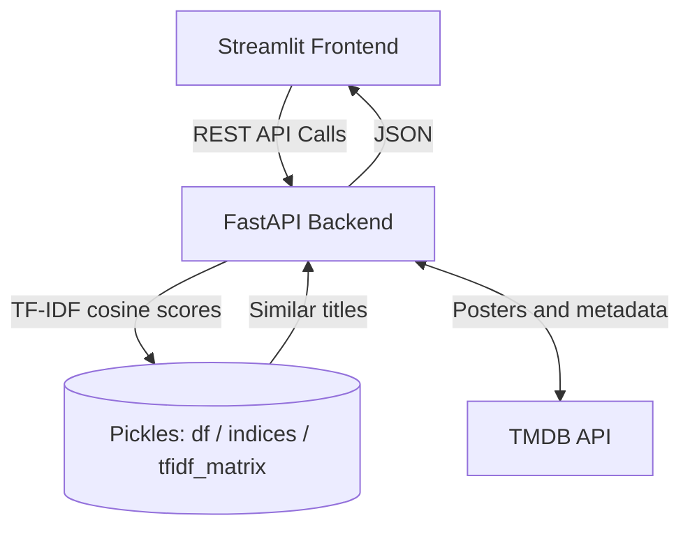

# Movie Recommendation System


A **demo** content-based movie recommender: TF-IDF + cosine similarity over local movie text, with a **FastAPI** backend and **Streamlit** frontend. Live posters and metadata come from the **TMDB** API.

> For agents and future-you: see [`AGENTS.md`](AGENTS.md) for architecture rules and what not to change (especially the ML pickles).

## Live links

- **Frontend (Streamlit):** [Movie Recommendation System](https://movierecommendationsystem-9xfckfbqbpftjzi4qubqgf.streamlit.app/)
- **Backend (Render):** [FastAPI Server](https://movie-recommendation-system-t86z.onrender.com)
- **API docs:** [Swagger UI](https://movie-recommendation-system-t86z.onrender.com/docs)

## Features

- Content-based recommendations (TF-IDF over overview / genres / tagline tags)
- Keyword search via TMDB
- Movie details (poster, genres, overview)
- Genre “more like this” via TMDB discover
- Interactive Streamlit UI (home feed → search → details → recommendations)

## Architecture



## Tech stack

- FastAPI + Uvicorn
- Streamlit
- scikit-learn / pandas / numpy / scipy (frozen artifacts at runtime)
- httpx (API ↔ TMDB), requests (Streamlit ↔ API)
- python-dotenv

## Machine learning (frozen)

Offline notebook builds a `tags` text field (overview + genres + tagline), fits `TfidfVectorizer`, and saves:

- `df.pkl` — movie rows + titles
- `indices.pkl` — title → row index
- `tfidf_matrix.pkl` — sparse TF-IDF matrix
- `tfidf.pkl` — fitted vectorizer (loaded; not required for online scoring)

**Runtime does not retrain.** Similarity is matrix · query_vector, top-N other titles.

## API endpoints

Base URL (production): `https://movie-recommendation-system-t86z.onrender.com`

| Method | Path | Notes |
|--------|------|--------|
| GET | `/health` | Health check |
| GET | `/home?category=trending&limit=24` | Home feed (`trending`, `popular`, `top_rated`, `now_playing`, `upcoming`) |
| GET | `/tmdb/search?query=batman` | Raw TMDB search JSON |
| GET | `/movie/id/{tmdb_id}` | Details |
| GET | `/recommend/genre?tmdb_id=27205` | Genre discover |
| GET | `/recommend/tfidf?title=Inception` | Local TF-IDF titles + scores |
| GET | `/movie/search?query=Inception` | Bundle by title |
| GET | `/movie/id/{tmdb_id}/recommendations` | Bundle by TMDB id (preferred from the UI details page) |

Examples:

```bash
curl -s "https://movie-recommendation-system-t86z.onrender.com/health"
curl -s "https://movie-recommendation-system-t86z.onrender.com/home?category=popular&limit=5"
curl -s "https://movie-recommendation-system-t86z.onrender.com/movie/id/27205"
```

Full interactive docs: `/docs` on the API host.

## Installation

**Prerequisites:** Python 3.11+ recommended (see `runtime.txt` / `.python-version`), Git, a TMDB API key.

```bash
git clone <repository_url>
cd <repository_name>
python3 -m venv env
source env/bin/activate  # Windows: env\Scripts\activate
pip install -r requirements.txt
```

## Environment variables

Create a `.env` in the project root for the API:

```env
TMDB_API_KEY=your_tmdb_api_key_here
```

Get a key: [TMDB](https://www.themoviedb.org/) → Settings → API → API Key (v3).

Optional for the Streamlit app:

```env
MOVIE_API_BASE=http://127.0.0.1:8000
```

If unset, the UI defaults to the production Render URL.

## Running locally

```bash
# Terminal 1 — API
uvicorn main:app --reload

# Terminal 2 — UI
MOVIE_API_BASE=http://127.0.0.1:8000 streamlit run app.py
```

- API: `http://127.0.0.1:8000`
- UI: `http://localhost:8501`

## Deployment

- **Backend:** Render web service (`requirements.txt` + Uvicorn), secret `TMDB_API_KEY`
- **Frontend:** Streamlit Community Cloud running `app.py` against the Render `API_BASE`

## Project structure

```text
.
├── AGENTS.md                          # Agent / contributor guide
├── app.py                             # Streamlit frontend
├── main.py                            # FastAPI backend
├── requirements.txt
├── runtime.txt
├── .streamlit/config.toml             # Streamlit theme
├── movie_recommendations_system.ipynb # Offline training / EDA
├── df.pkl / indices.pkl / tfidf*.pkl  # Frozen ML artifacts
├── docs/superpowers/specs/            # Design notes
├── LICENSE
└── README.md
```

## Future ideas (not in this demo)

- Hybrid collaborative filtering
- User accounts / watchlists
- Richer filters (year, cast)
- Optional response caching if traffic grows

## License

[MIT License](LICENSE)
